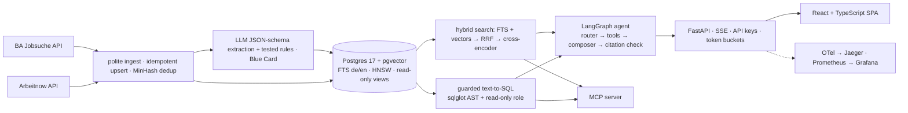

# JobScout

**Find skilled jobs in Germany you can get without fluent German.** JobScout filters for "English is enough", visa/relocation support and stated salary, gives an indicative EU Blue Card check against the 2026 thresholds, answers questions in your language with citations to the ads it used, matches your CV without storing it, and publishes market insights.

## Features
- **Search** with filters for city, remote policy, seniority, skills, language, visa support, salary and Blue Card status.
- **Assistant** built on LangGraph: guarded read-only text-to-SQL, hybrid search and citation checking, streamed over SSE.
- **CV match** with per-posting skill, language and experience gaps. CVs are processed in memory.
- **Market insights** on English-friendliness, salary transparency and top skills, plus saved searches as RSS/Atom feeds.
- **MCP server** exposing five of the agent's tools with the same guardrails.
- **Infrastructure:** Docker Compose stack, Helm chart for Kubernetes (run on a local kind cluster), an Argo CD application, and Terraform for Google Cloud (validated, not applied).

## Architecture

More detail: [docs/ARCHITECTURE.md](docs/ARCHITECTURE.md).

## Evaluation
Mistral 7B as the agent and Llama 3.2 as the judge, both local via Ollama. 80-question golden set, reviewed by hand, on 2,651 active postings in Germany from the Bundesagentur für Arbeit and Arbeitnow.

| Metric | Value | Source |
|---|---|---|
| Tool-selection accuracy (all / SQL / search / multi-step / CV) | 72.5% / 100% / 100% / 0% / 12.5% | `make eval-full` |
| SQL execution accuracy (result-set match) | 60% | `make eval-full` |
| Agent's first search: recall@5 / MRR | 0.65 / 0.91 | `make eval-full` |
| Citation precision (first draft, before the citation check) | 70.1% | `make eval-full` |
| Out-of-scope and adversarial requests refused | 6 of 7 | `make eval-full` |
| Latency p50 / p95 (local hardware) | 34 s / 117 s | `make eval-full` |
| Retrieval recall@5 / MRR: hybrid+rerank · dense · hybrid (RRF only) · full-text | 0.67/0.91 · 0.51/0.78 · 0.39/0.55 · 0.17/0.29 | `make retrieval-bench` |
| Single-shot RAG vs agent (MRR · citation precision · p95) | 0.91 vs 0.91 · 98.7% vs 85.0% · 41 s vs 133 s | `make ablations` |
| LLM judge vs hand labels (20 answers) | 75% agreement, Cohen's kappa 0.49 | `make judge-agreement` |

Reranking is the biggest retrieval gain. Search works well, while multi-step and CV questions don't: this local model usually calls one tool and stops. Judge agreement is moderate, so judge scores are not quoted here. Full tables and conclusions, including what got worse: [docs/EVALUATION.md](docs/EVALUATION.md).

## Run it locally
Prerequisites: Docker Desktop, [uv](https://docs.astral.sh/uv/), Node ≥ 20.19 with corepack, and [Ollama](https://ollama.com) with `mistral:latest`, `llama3.2:latest` and `bge-m3:latest` pulled.

```bash
cp .env.example .env
make setup      # Python 3.12 venv, pnpm dependencies, secret-scan hook
make up         # API + web on http://localhost:8088, Jaeger :16686, Prometheus :9091, Grafana :3001
```
A fresh clone starts with a small fictional demo corpus. To load real postings, run `make pipeline` (slow with local models).

```bash
make test       # backend + frontend tests
make lint       # ruff, mypy --strict, ESLint, Prettier, tsc, gitleaks
make eval-smoke # replayed evaluation, no API keys needed
make mcp        # MCP server over stdio
make k8s-up     # local Kubernetes: kind cluster + Helm install
```

## Status
JobScout is under development.

## Limitations
- Results come from local models and do not describe hosted models.
- The agent fails multi-step questions and CV questions in chat, and 40% of its SQL answers are wrong. Answer checks catch some invented numbers, but not all.
- Most postings use rule-based extraction (2,775 rules, 228 LLM). Salary extraction favours precision, so some stated salaries are missed, and most ads state none.
- Semantic labels are rule-based, reviewed by one person, and judge agreement rests on 20 answers.
- Local latency is high: a median of about 34 seconds per question.
- The data is one load from 1 November 2026. Weekly ingestion is not scheduled, and only 20 postings have been checked for expiry.
- Not deployed, and no real users yet. The Argo CD application and Terraform have not been applied. Posting texts are stored only in the local database and are not in this repository.

## Roadmap
- **Better answers:** repeat the evaluation with a stronger model through the existing `LLM_PROVIDER` switch.
- **Better data:** finish LLM extraction for all postings, then re-measure rules against LLM agreement.
- **Freshness:** complete expiry checks for all postings and schedule ingestion weekly.
- **Deployment:** publish a hosted demo with data from the Bundesagentur für Arbeit only, then install Argo CD on the kind cluster and sync the application.

## Data and licence
Jobs from [Arbeitnow](https://www.arbeitnow.com) and the [Bundesagentur für Arbeit Jobsuche](https://www.arbeitsagentur.de/jobsuche/). Blue Card information is indicative only, not legal advice. Licensed under [MIT](LICENSE).
