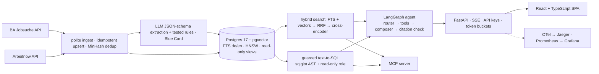

# JobScout

**Find skilled jobs in Germany you can actually get without fluent German.** JobScout filters for "English is enough", visa/relocation support and stated salary, gives an indicative EU Blue Card check against the 2026 thresholds, answers questions in your language with citations to the ads it used, matches your CV without storing it, and publishes market insights.

## Features
- **Search** with filters for city, remote policy, seniority, skills, language, visa support, salary and Blue Card status.
- **Assistant** built on LangGraph: guarded read-only text-to-SQL, hybrid search and citation checking, streamed over SSE.
- **CV match** with per-posting skill, language and experience gaps. CVs are processed in memory.
- **Market insights** on English-friendliness, salary transparency and top skills, plus saved searches as RSS/Atom feeds.
- **MCP server** exposing the same tools and guardrails.

## Architecture

More detail: [docs/ARCHITECTURE.md](docs/ARCHITECTURE.md).

## Evaluation
Local Mistral 7B via Ollama, 80-question golden set, 3,003 active de-duplicated postings from the Bundesagentur für Arbeit and Arbeitnow.

| Metric | Value | Source |
|---|---|---|
| Tool-selection accuracy (all / SQL / semantic / multi-step / CV) | 70% / 100% / 96% / 0% / 12.5% | `make eval-full` |
| SQL execution accuracy (result-set match) | 60% | `make eval-full` |
| Agent's first search: recall@5 / MRR | 0.32 / 0.61 | `make eval-full` |
| Citation precision (first draft, before the citation check) | 67.4% | `make eval-full` |
| Explicit refusals on out-of-scope/adversarial / over-refusal | 0 of 7 / 0% | `make eval-full` |
| Latency p50 / p95 (local hardware, shared with other jobs) | 35 s / 125 s | `make eval-full` |
| Retrieval recall@5 / MRR: hybrid+rerank · dense · full-text · hybrid (RRF only) | 0.44/0.84 · 0.35/0.74 · 0.09/0.26 · 0.24/0.51 | `make retrieval-bench` |
| Single-shot RAG vs agent on search questions (MRR, p50 latency) | RAG wins: 0.84 vs 0.61, 27 s vs 71 s | `make ablations` |

Reranking is the biggest retrieval gain, and for search-only questions a plain retrieve-then-answer pipeline beats the agent. Full tables and conclusions, including what got worse: [docs/EVALUATION.md](docs/EVALUATION.md).

## Run it locally
Prerequisites: Docker Desktop, [uv](https://docs.astral.sh/uv/), Node ≥ 20.19 with corepack, and [Ollama](https://ollama.com) with `mistral:latest` and `bge-m3:latest` pulled.

```bash
cp .env.example .env
make setup      # Python 3.12 venv, pnpm dependencies, secret-scan hook
make up         # API + web on http://localhost:8088, Jaeger :16686, Prometheus :9091, Grafana :3001
```
A fresh clone starts with a small fictional demo corpus. To load real postings, run `make pipeline` (slow with local models).

```bash
make test       # backend + frontend tests
make lint       # ruff, mypy --strict, ESLint, Prettier, tsc, gitleaks
make eval-smoke # replayed evaluation, no API keys needed
make mcp        # MCP server over stdio
```

## Limitations
- Results come from a local 7B model and do not describe hosted models.
- Most postings use rule-based extraction (2,775 rules, 228 LLM), because local LLM throughput is limited.
- Golden-set expected answers are generated from reference SQL and rule-based predicates. LLM-judge scores are uncalibrated, so they are not quoted here.
- The agent is weak on multi-step questions and does not reliably refuse out-of-scope requests.
- Local latency is high: a median of about 35 seconds per question.
- Not deployed. Posting texts are stored only in the local database and are not in this repository.

## Data and licence
Jobs from [Arbeitnow](https://www.arbeitnow.com) and the [Bundesagentur für Arbeit Jobsuche](https://www.arbeitsagentur.de/jobsuche/). Blue Card information is indicative only, not legal advice. Licensed under [MIT](LICENSE).
