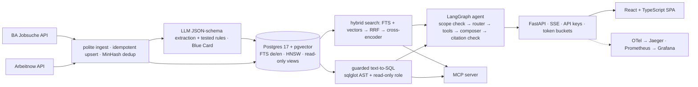

# JobScout

**Find skilled jobs in Germany you can get without fluent German.** JobScout filters for "English is enough", visa/relocation support and stated salary, gives an indicative EU Blue Card check against the 2026 thresholds, answers questions in your language with citations to the ads it used, matches your CV without storing it, and publishes market insights.

## Features
- **Search** with filters for city, remote policy, seniority, skills, language, visa support, salary and Blue Card status.
- **Assistant** built on LangGraph: a scope check that refuses off-topic questions, guarded read-only text-to-SQL, hybrid search, repair of invalid tool arguments and citation checking, streamed over SSE.
- **CV match** with per-posting skill, language and experience gaps. CVs are processed in memory.
- **Market insights** on English-friendliness, salary transparency and top skills, plus saved searches as RSS/Atom feeds.
- **MCP server** exposing five of the agent's tools with the same guardrails.
- **Infrastructure:** Docker Compose stack, Helm chart for Kubernetes (run on a local kind cluster), an Argo CD application, and Terraform for Google Cloud (validated, not applied).

## Architecture

More detail: [docs/ARCHITECTURE.md](docs/ARCHITECTURE.md).

## Evaluation
Local Mistral 7B via Ollama, 80-question golden set, 3,003 active de-duplicated postings from the Bundesagentur für Arbeit and Arbeitnow. These results predate the scope check and tool-argument repair, so the agent rows below describe the earlier version until the evaluation is rerun.

| Metric | Value | Source |
|---|---|---|
| Tool-selection accuracy (all / SQL / semantic / multi-step / CV) | 70% / 100% / 96% / 0% / 12.5% | `make eval-full` |
| SQL execution accuracy (result-set match) | 60% | `make eval-full` |
| Agent's first search: recall@5 / MRR | 0.32 / 0.61 | `make eval-full` |
| Citation precision (first draft, before the citation check) | 67.4% | `make eval-full` |
| Explicit refusals on out-of-scope/adversarial / over-refusal | 0 of 7 / 0% | `make eval-full` |
| Latency p50 / p95 (local hardware, shared with other jobs) | 35 s / 125 s | `make eval-full` |
| Retrieval recall@5 / MRR: hybrid+rerank · dense · full-text · hybrid (RRF only) | 0.44/0.84 · 0.35/0.74 · 0.09/0.26 · 0.24/0.51 | `make retrieval-bench` |
| Single-shot RAG vs agent on search questions (MRR, p50 latency) | RAG wins: 0.84 vs 0.61, 27 s vs 71 s | `make ablations` |

The scope check was measured separately with `make scope-bench`: it allowed 85 of 85 on-topic questions and refused 25 of 29 off-topic questions, with a median of 213 ms per question. One example was added after it wrongly refused an on-topic question, so 85 of 85 is not a fully unseen result.

Reranking is the biggest retrieval gain, and for search-only questions a plain retrieve-then-answer pipeline beats the agent. Full tables and conclusions, including what got worse: [docs/EVALUATION.md](docs/EVALUATION.md).

## Run it locally
Prerequisites: Docker Desktop, [uv](https://docs.astral.sh/uv/), Node ≥ 20.19 with corepack, and [Ollama](https://ollama.com) with `mistral:latest` and `bge-m3:latest` pulled.

```bash
cp .env.example .env
make setup      # Python 3.12 venv, pnpm dependencies, secret-scan hook
make up         # API + web on http://localhost:8088, Jaeger :16686, Prometheus :9091, Grafana :3001
```
A fresh clone starts with a small fictional demo corpus. To load real postings, run `make pipeline` (slow with local models).

```bash
make test       # backend + frontend tests
make lint       # ruff, mypy --strict, ESLint, Prettier, tsc, gitleaks
make eval-smoke # replayed evaluation, no API keys needed
make mcp        # MCP server over stdio
make k8s-up     # local Kubernetes: kind cluster + Helm install
```

## Status
JobScout is under development.

## Limitations
- Results come from a local 7B model and do not describe hosted models.
- Most postings use rule-based extraction (2,775 rules, 228 LLM), because local LLM throughput is limited.
- Golden-set expected answers are generated from reference SQL and rule-based predicates. LLM-judge scores are uncalibrated, so they are not quoted here.
- The agent is weak on multi-step questions, and the local models tested also make SQL mistakes. Repair fixes invalid posting IDs and CV profiles, but not invalid SQL.
- If a model sends an invalid posting ID, repair uses the first search result, so a request about a later result can check the wrong posting.
- The scope check still allows some off-topic questions, such as jobs outside Germany.
- Local latency is high: a median of about 35 seconds per question.
- Freshness checks are incomplete: 20 of the 3,294 stored postings have been checked so far, so most show "Last checked: never".
- Not deployed. The Argo CD application and Terraform have not been applied. Posting texts are stored only in the local database and are not in this repository.

## Roadmap
- **Better answers:** repeat the evaluation with a hosted model through the existing `LLM_PROVIDER` switch.
- **Better data:** finish LLM extraction for all postings, then re-measure rules against LLM agreement.
- **Trustworthy evaluation:** review the golden-set expected answers by hand and calibrate the LLM judge against hand labels.
- **Stronger model:** compare a larger local model on the same questions, then rerun the full evaluation with the chosen model.
- **Multi-step questions:** make follow-up tools reliable after a search, then measure the existing supervisor mode.
- **Out-of-scope requests:** extend the scope check to questions about other countries and run it on the supervisor path.
- **Lower latency:** add a single-shot RAG path to the product for search-only questions. It was faster and scored better in the evaluation, where it exists today.
- **Freshness:** complete expiry checks for all postings and schedule them weekly.
- **Deployment:** publish a hosted demo with data from the Bundesagentur für Arbeit only, then install Argo CD on the kind cluster and sync the application.

## Data and licence
Jobs from [Arbeitnow](https://www.arbeitnow.com) and the [Bundesagentur für Arbeit Jobsuche](https://www.arbeitsagentur.de/jobsuche/). Blue Card information is indicative only, not legal advice. Licensed under [MIT](LICENSE).
