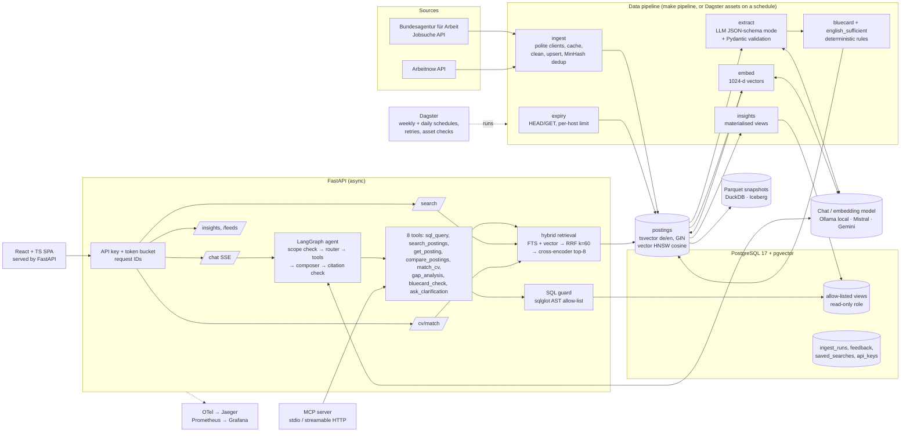

# Architecture

## Orchestration
The pipeline functions run either by hand (`make pipeline`) or as Dagster assets (`jobscout/orchestration/`). Dagster adds per-source partitions, retries for network steps, blocking contract and privacy checks, a run-failure sensor with a Prometheus counter, and a columnar snapshot (Parquet → DuckDB, plus an Iceberg table) next to Postgres. The snapshot is for analytics across weeks, and Postgres stays the store that serves the app. It runs in Compose (code server, webserver and daemon; storage in a separate `dagster` database) and on kind with the official Helm chart (K8sRunLauncher, one Kubernetes Job per run). Details: [ORCHESTRATION.md](ORCHESTRATION.md).

## Request path of a chat question
1. Browser `POST /api/chat` with an API key → auth (SHA-256 hash lookup, constant-time compare) → token bucket → request ID.
2. The LangGraph `StateGraph` runs: **scope check** (bge-m3 compares the question with on-topic and off-topic examples; an off-topic question is refused before the LLM runs) → **route check** (a first question that only needs a role or skill search runs one search and goes straight to the composer) → **router** (LLM with function calling decides tools) → **tools** (independent calls run concurrently, then calls that need their results; invalid posting IDs and CV profiles are repaired) → back to router until it stops calling tools or hits the **6-step cap** → **composer** writes the answer from tool outputs (wrapped as untrusted data) → **citation check** (every `[posting_id]` must have been retrieved; one regeneration, then a warning).
3. Events stream back as SSE: `token`, `tool_call`, `tool_result`, `citation`, `done`.
4. Every step is an OpenTelemetry span; latency, tokens, tool errors and guard rejections are Prometheus metrics.

## Data model (main table `postings`)
Identity (`id`, `source`, `source_id`, `url`), cleaned text (`raw_text`, DB only, never committed), all extracted fields as typed columns, derived fields (`english_sufficient`, `bluecard_status`, `annual_salary_eur`), freshness (`is_active`, `last_checked_at`, `consecutive_failures`), provenance (`model_version`, `schema_version`, `content_hash`), search (`tsv_de`, `tsv_en`, `embedding vector(1024)`).

