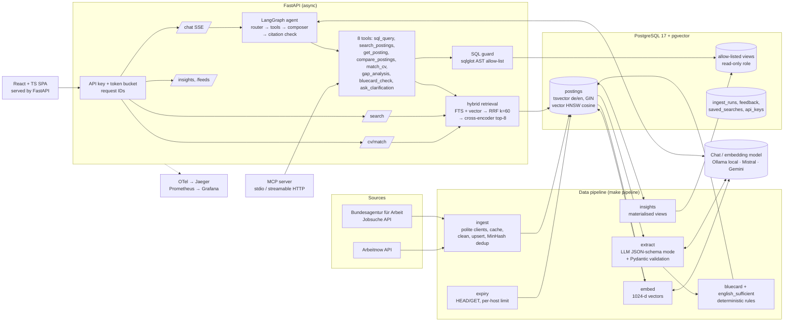

# Architecture

## Request path of a chat question
1. Browser `POST /api/chat` with an API key → auth (SHA-256 hash lookup, constant-time compare) → token bucket → request ID.
2. The LangGraph `StateGraph` runs: **router** (LLM with function calling decides tools) → **tools** (independent calls run concurrently) → back to router until it stops calling tools or hits the **6-step cap** → **composer** writes the answer from tool outputs (wrapped as untrusted data) → **citation check** (every `[posting_id]` must have been retrieved; one regeneration, then a warning).
3. Events stream back as SSE: `token`, `tool_call`, `tool_result`, `citation`, `done`.
4. Every step is an OpenTelemetry span; latency, tokens, tool errors and guard rejections are Prometheus metrics.

## Data model (main table `postings`)
Identity (`id`, `source`, `source_id`, `url`), cleaned text (`raw_text`, DB only, never committed), all extracted fields as typed columns, derived fields (`english_sufficient`, `bluecard_status`, `annual_salary_eur`), freshness (`is_active`, `last_checked_at`, `consecutive_failures`), provenance (`model_version`, `schema_version`, `content_hash`), search (`tsv_de`, `tsv_en`, `embedding vector(1024)`).

